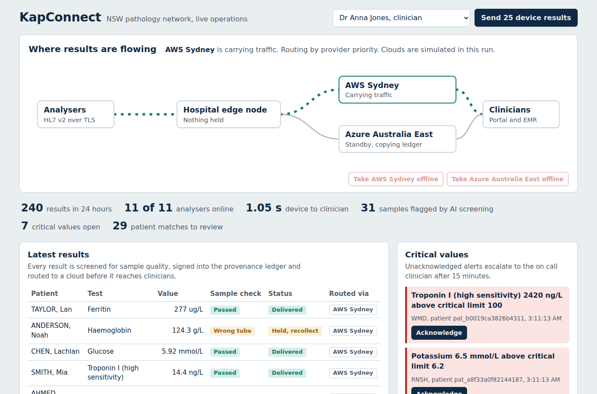
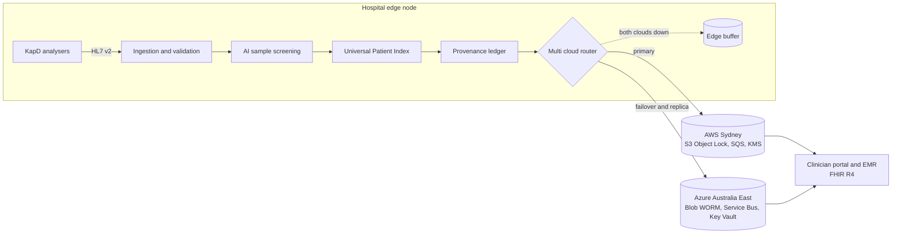
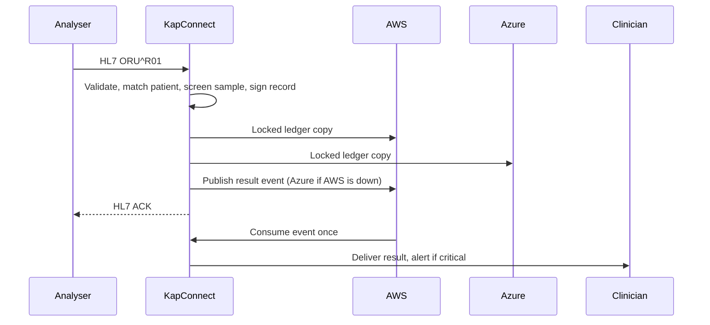
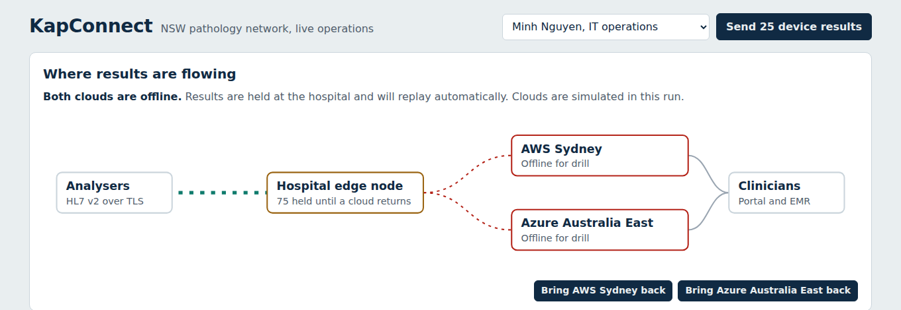

<<<<<<< HEAD
# KapConnect

**A multi cloud healthcare integration platform on AWS and Azure that keeps pathology results flowing, provable and affordable, even when a cloud region goes down.**

[](https://github.com/yeamin1414/kapconnect/actions/workflows/ci.yml)




## In 30 seconds

| | |
| --- | --- |
| **What it is** | The digital services layer between hospital analysers and the systems clinicians use. It receives HL7 v2 results, screens samples with machine learning, signs every result into a tamper evident ledger and routes events across AWS and Azure. |
| **The problem it solves** | Disconnected systems, manual retyping of results, outages that stop clinical work, no way to prove where a result came from, and cloud bills nobody can explain. |
| **What makes it different** | Health aware failover between two clouds, a hospital edge buffer for total outages, write once ledger copies in both clouds with one click repair, a data key protected by both cloud key services, and cost per result reporting. |
| **Proof it works** | 58 automated tests (87% coverage) run on every push. The AWS adapter is tested against moto and the Azure adapter against Azurite, Microsoft's official storage emulator. |
| **Deploys to** | AWS ECS Fargate and Azure Container Apps with Terraform, through GitHub Actions using OIDC and no stored cloud keys. |

Originally designed for the Deloitte Engineering Design Challenge (UTS Engineering Society, August 2026), then built out as a working system.

## Contents

* [Why this project exists](#why-this-project-exists)
* [Five things that set it apart](#five-things-that-set-it-apart)
* [Architecture](#architecture)
* [AWS and Azure services used](#aws-and-azure-services-used)
* [Run it in two minutes](#run-it-in-two-minutes)
* [Try the resilience drills](#try-the-resilience-drills)
* [API overview](#api-overview)
* [Deploy to the cloud](#deploy-to-the-cloud)
* [Testing and quality](#testing-and-quality)
* [Measured results](#measured-results)
* [Project structure](#project-structure)
* [Design decisions and trade offs](#design-decisions-and-trade-offs)
* [Known limitations](#known-limitations)
* [Skills demonstrated](#skills-demonstrated)

## Why this project exists

Enterprise teams keep running into the same cloud problems, and healthcare feels each one sharply:

| Recurring enterprise problem | How KapConnect handles it |
| --- | --- |
| A single cloud region fails and operations stop | Circuit breakers fail over from AWS to Azure automatically. If both are down, the hospital node keeps accepting results and replays them later. |
| Vendor lock in | Three small provider interfaces let the same business logic run on AWS, Azure or both. |
| Audit and compliance evidence is hard to produce | Every result has a signed provenance record copied to locked storage in both clouds, plus a live compliance posture endpoint. |
| Nobody can explain the cloud bill | Every cloud call is metered by provider, operation and hospital, giving cost per result and a monthly projection. |
| Secrets and keys leak | Workloads use IAM roles and managed identity, account keys are disabled, and deployments use OIDC. |
| Data sovereignty | Terraform refuses regions outside Australia, and Azure Policy enforces it at the resource group. |
| Messages lost or processed twice | At least once delivery, idempotent consumers, and dead letter queues on both clouds. |

## Five things that set it apart

1. **Health aware multi cloud routing.** Each provider has a circuit breaker. After repeated failures traffic moves to the other cloud with no request waiting on a timeout. You can switch between priority routing and lowest cost routing at runtime.
2. **Store and forward at the hospital edge.** When every cloud is unreachable, operations go into a transactional outbox next to the result. Results are still acknowledged to the analyser and are replayed automatically when a cloud returns.
3. **Tamper evident provenance with self repair.** Each Result Provenance Record is hash chained and signed, then written to S3 Object Lock and Azure immutable Blob Storage. A tamper drill edits the database, verification finds the exact entry, and repair restores it from the locked cloud copy.
4. **Cross cloud key escrow.** Patient demographics use envelope encryption. The same data key is wrapped by AWS KMS and Azure Key Vault, so losing one key service does not lock you out of patient data.
5. **FinOps built in.** Cost per result, spend by cloud and hospital, budget tracking, and AWS Budgets plus Azure consumption budgets in Terraform.

## Architecture



How one result moves:



Full diagrams, including outage recovery, recall and tamper repair, are in [docs/architecture.md](docs/architecture.md).

## AWS and Azure services used

| Capability | AWS | Azure | Code |
| --- | --- | --- | --- |
| Write once ledger storage | S3 Object Lock (COMPLIANCE), SSE KMS, lifecycle to Glacier Instant Retrieval | Blob Storage with container WORM policy, ZRS | `app/cloud/aws.py`, `app/cloud/azure.py` |
| Messaging with dead letters | SQS with redrive policy | Service Bus with duplicate detection, or Storage Queues on Azurite | same |
| Envelope encryption | KMS customer managed key with rotation | Key Vault RSA key with RBAC | same |
| Compute | ECS Fargate behind an Application Load Balancer | Container Apps | `infra/terraform/*/` |
| Identity | IAM task role with least privilege | User assigned managed identity with data plane roles | Terraform |
| Secrets | Secrets Manager | Container Apps secrets | Terraform |
| Container registry | ECR with scan on push | GitHub Container Registry | `.github/workflows/deploy.yml` |
| Monitoring | CloudWatch Logs, Container Insights, alarms, SNS | Log Analytics, diagnostic settings, metric alerts | Terraform |
| Cost control | AWS Budgets with tag filter | Consumption budget | Terraform |
| Governance | Region validation | Azure Policy allowed locations | Terraform |
| CI/CD identity | OIDC role assumption | OIDC federated login | `.github/workflows/deploy.yml` |

## Run it in two minutes

**Option 1: Docker, no cloud account needed**

```bash
git clone https://github.com/yeamin1414/kapconnect.git
cd kapconnect
docker compose up --build
```

Open http://localhost:8000 and click **Send 25 device results**. Interactive API docs are at http://localhost:8000/docs.

**Option 2: Python**

```bash
python -m venv .venv && source .venv/bin/activate
make install
make run
# in a second terminal, stream traffic from the device simulator
make simulate
```

**Option 3: Real AWS and Azure SDKs against local emulators**

```bash
docker compose --profile emulators up --build
```

This starts LocalStack (S3, SQS, KMS) and Azurite (Blob, Queue), and runs a second instance on http://localhost:8001 that uses the real boto3 and Azure SDK code paths. Recent LocalStack releases may ask for a free auth token; set `LOCALSTACK_AUTH_TOKEN` if so.

By default the app runs with `KAP_CLOUD_PROVIDERS=aws_sim,azure_sim`: two offline providers with the same semantics as the real ones (write once objects, retries, dead letters, key wrapping). Change it to `aws,azure` to use the real adapters.

**Demo logins** (password `kapconnect` for all)

| Username | Role | Can do |
| --- | --- | --- |
| `tech.lee` | Lab technician | See results with names, run recalls, view screening model |
| `dr.jones` | Clinician | See results with names, acknowledge critical values |
| `admin.patel` | Hospital administrator | Decide patient matches (identity shown only in the audited review queue), view costs, compliance and audit |
| `ops.nguyen` | IT operations | Run outage and tamper drills, replay buffers, never sees patient identity |
| `sigma.device` | Analyser | Send HL7 messages only |

## Try the resilience drills

In the console, sign in as **Minh Nguyen, IT operations** and use the buttons on the route map. The same drills from a terminal:

```bash
TOKEN=$(curl -s -X POST localhost:8000/api/v1/auth/token \
  -d "username=ops.nguyen&password=kapconnect" | python -c "import sys,json;print(json.load(sys.stdin)['access_token'])")
AUTH="Authorization: Bearer $TOKEN"

# 1. Take AWS offline and send traffic: results fail over to Azure
curl -s -X POST localhost:8000/api/v1/cloud/providers/aws/outage -H "$AUTH" -H "Content-Type: application/json" -d '{"down": true}'
curl -s -X POST localhost:8000/api/v1/demo/traffic -H "$AUTH" -H "Content-Type: application/json" -d '{"count": 20}'

# 2. Take Azure offline too: results are held at the hospital edge
curl -s -X POST localhost:8000/api/v1/cloud/providers/azure/outage -H "$AUTH" -H "Content-Type: application/json" -d '{"down": true}'
curl -s -X POST localhost:8000/api/v1/demo/traffic -H "$AUTH" -H "Content-Type: application/json" -d '{"count": 10}'
curl -s localhost:8000/readyz

# 3. Restore both clouds: held operations replay automatically
curl -s -X POST localhost:8000/api/v1/cloud/providers/aws/outage -H "$AUTH" -H "Content-Type: application/json" -d '{"down": false}'
curl -s -X POST localhost:8000/api/v1/cloud/providers/azure/outage -H "$AUTH" -H "Content-Type: application/json" -d '{"down": false}'

# 4. Tamper with ledger entry 3, detect it, repair it from locked cloud storage
curl -s -X POST localhost:8000/api/v1/ledger/3/tamper-drill -H "$AUTH"
curl -s localhost:8000/api/v1/ledger/verify -H "$AUTH"
curl -s -X POST localhost:8000/api/v1/ledger/3/repair -H "$AUTH"

# 5. Send a malformed event and watch it reach the dead letter queue after retries
curl -s -X POST localhost:8000/api/v1/cloud/drills/poison-message -H "$AUTH"
sleep 8 && curl -s localhost:8000/api/v1/cloud/dead-letters -H "$AUTH"
```



A scripted interview walkthrough and answers to common technical questions are in [docs/demo-guide.md](docs/demo-guide.md).

## API overview

| Method and path | Purpose | Permission |
| --- | --- | --- |
| `POST /api/v1/auth/token` | Sign in, returns a JWT | none |
| `POST /api/v1/ingest/hl7` | Ingest an HL7 v2 ORU^R01 message, returns JSON or an HL7 ACK | `ingest` |
| `GET /api/v1/results` | Latest results, masked by role | `results:read` |
| `GET /api/v1/results/{id}` | Result with provenance, deliveries and FHIR R4 bundle | `results:read` |
| `GET /api/v1/patients/reviews` | Likely duplicate patients waiting for a decision | `reviews:decide` |
| `POST /api/v1/patients/reviews/{id}/decision` | Link or keep records separate | `reviews:decide` |
| `GET /api/v1/alerts` and `POST /api/v1/alerts/{id}/acknowledge` | Critical values | `alerts:ack` to acknowledge |
| `GET /api/v1/recall/{batch}` | Every patient affected by a reagent batch | `recall:run` |
| `GET /api/v1/ledger/verify` | Check the hash chain and cloud replicas | `ledger:read` |
| `POST /api/v1/ledger/{seq}/tamper-drill` and `/repair` | Tamper and self repair drills | `ledger:operate` |
| `GET /api/v1/cloud/status` | Route, breaker states, edge buffer depth | signed in |
| `POST /api/v1/cloud/providers/{name}/outage` | Start or end an outage drill | `cloud:operate` |
| `POST /api/v1/cloud/strategy` | Switch between priority and lowest cost routing | `cloud:operate` |
| `POST /api/v1/cloud/drain` | Replay the edge buffer now | `cloud:operate` |
| `GET /api/v1/cloud/dead-letters` | Dead letter queue contents in each cloud | `cloud:operate` |
| `GET /api/v1/finops/costs` | Cost per result, by cloud, by hospital, projection | `finops:read` |
| `GET /api/v1/compliance/posture` | Runtime compliance checks | `compliance:read` |
| `GET /api/v1/screening/model` | Model card with holdout metrics | `screening:read` |
| `GET /healthz`, `/readyz`, `/metrics` | Probes and Prometheus metrics | none |

## Deploy to the cloud

**AWS (ECS Fargate)**

```bash
cd infra/terraform/aws
cp terraform.tfvars.example terraform.tfvars   # set alert_email and allowed_ingress_cidrs
terraform init && terraform apply

# push the image the service expects
REPO=$(terraform output -raw ecr_repository_url)
aws ecr get-login-password --region ap-southeast-2 | docker login --username AWS --password-stdin ${REPO%/*}
docker build -t $REPO:1.0.0 ../../.. && docker push $REPO:1.0.0
terraform output app_url
```

Creates a KMS key with rotation, an S3 bucket with Object Lock, versioning, TLS enforcement and lifecycle tiering, SQS with a dead letter queue, Secrets Manager, ECR, an ECS Fargate service behind an ALB with deployment circuit breaker and rollback, CloudWatch alarms and an AWS Budget.

**Azure (Container Apps)**

```bash
cd infra/terraform/azure
cp terraform.tfvars.example terraform.tfvars   # set subscription_id and alert_email
az login
terraform init && terraform apply
terraform output app_url
```

Creates a resource group with an allowed locations policy, a ZRS storage account with a WORM container and account keys disabled, a Service Bus namespace with SAS disabled, Key Vault with RBAC and purge protection, a managed identity with least privilege roles, Container Apps, Log Analytics, a dead letter alert and a consumption budget. The container image must be public in GHCR, or add a registry block.

**CI/CD.** `.github/workflows/ci.yml` runs on every push: ruff, pytest with coverage against moto and Azurite, a Docker build and smoke test, a Trivy image scan, and `terraform validate` for both clouds. `.github/workflows/deploy.yml` deploys on demand to either or both clouds using OIDC.

## Testing and quality

```bash
make test    # 58 tests, about 45 seconds
make lint    # ruff lint and format check
```

| Test file | What it proves |
| --- | --- |
| `test_router.py` | Failover, edge buffering and replay, partial outage healing, breaker states, cost routing, dead letters, metering |
| `test_cloud_adapters.py` | S3 Object Lock blocks overwrite and delete, KMS wrap and unwrap, SQS redrive, full platform on the AWS SDK, Azure Blob and queue poison handling on Azurite |
| `test_api.py` | End to end ingestion and delivery, idempotent retries, HL7 rejects, held samples, critical value escalation, role based masking, outage drills, recall, tamper repair, match decisions |
| `test_ledger_screening.py` | Chain integrity, tamper detection, repair from the second cloud, model quality thresholds, guardrails |
| `test_matching.py` | Jaro Winkler and Soundex reference values, scoring bands, no automatic merges, encryption at rest |
| `test_hl7_fhir.py` | HL7 parsing, escape sequences, validation errors, ACKs, FHIR R4 bundle structure |

Azure adapter tests run when `AZURITE_CONNECTION_STRING` is set, which CI does automatically.

## Measured results

Measured on a single process with both simulated clouds, 3,000 results.

| Measure | Result |
| --- | --- |
| Ingestion, including dual cloud ledger replication | about 100 results per second, 10 ms each |
| Event delivery for 3,000 results | 0.7 seconds |
| Reagent recall across 3,000 results (300 matched, 108 patients) | under 4 ms |
| Full ledger verification, 3,000 entries | about 50 ms |
| Screening: bad samples caught (synthetic holdout) | 98.6% |
| Screening: good samples wrongly held (synthetic holdout) | 2.6% |
| Screening: macro F1 (synthetic holdout) | 0.95 |
| Cloud cost per result at illustrative list prices | about A$0.00002 |

## Project structure

```
kapconnect/
├── app/
│   ├── api/                 REST routes and auth dependencies
│   ├── cloud/               Provider interfaces, AWS and Azure adapters, router, FinOps
│   ├── core/                Security, envelope encryption, metrics
│   ├── integration/         HL7 v2 parser and FHIR R4 mapper
│   ├── screening/           AI pre analytical screening
│   ├── mpi/                 Universal Patient Index
│   ├── provenance/          Hash chained ledger
│   ├── alerts/              Critical values and escalation
│   ├── governance/          Compliance posture
│   ├── storage/             Repository layer
│   ├── static/              Operations console
│   ├── platform.py          End to end orchestration
│   └── main.py              FastAPI application
├── simulator/               KapD analyser fleet simulator
├── infra/terraform/aws/     ECS Fargate, S3, SQS, KMS, IAM, CloudWatch, Budgets
├── infra/terraform/azure/   Container Apps, Blob, Service Bus, Key Vault, Policy, Monitor
├── tests/                   58 tests
├── docs/                    Architecture, demo guide, screenshots
├── config/                  Pricing table and Prometheus config
├── .github/workflows/       CI and OIDC deployment
├── Dockerfile
└── docker-compose.yml
```

## Design decisions and trade offs

| Decision | Why | Trade off |
| --- | --- | --- |
| Provider interfaces instead of one cloud SDK | Enables failover, dual writes and cost routing | Only features common to both clouds are used directly |
| Dual write the ledger, single route the events | Evidence must exist everywhere; events only need delivering once | Ledger writes cost roughly double |
| Transactional outbox at the edge | No result is lost during a full outage | The hospital node needs local storage |
| Never merge patients automatically | A wrong merge is a patient safety event | Administrators have a review queue to work through |
| Held samples do not page clinicians | Haemolysis often causes falsely high potassium | Recollection is needed before a real critical value is confirmed |
| SQLite operational store | One command demo with no database server | Single replica until moved to PostgreSQL |
| Synthetic training data | No access to real laboratory data | Metrics show the pipeline works, not clinical accuracy |

## Known limitations

* The operational store is SQLite, so Terraform runs one replica. The next step is Aurora PostgreSQL or Azure Database for PostgreSQL.
* The screening model and its metrics come from synthetic data and are not validated for clinical use.
* Cloud prices in `config/pricing.json` are illustrative and should be refreshed from the AWS Price List API and the Azure Retail Prices API.
* Demo users are built in. Production would federate with Amazon Cognito or Microsoft Entra ID.
* Critical value limits are examples and must be confirmed by each laboratory.
* All patient data is synthetic. Medicare numbers pass the check digit rule but are randomly generated.

## Skills demonstrated

**Cloud:** AWS (S3 Object Lock, SQS, KMS, ECS Fargate, ECR, ALB, IAM, Secrets Manager, CloudWatch, SNS, Budgets), Microsoft Azure (Blob Storage immutability, Service Bus, Storage Queues, Key Vault, Container Apps, Managed Identity, Azure Policy, Log Analytics, Azure Monitor, Cost Management), multi cloud architecture, high availability, disaster recovery, FinOps.

**Engineering:** Python, FastAPI, REST API design, event driven architecture, circuit breaker, transactional outbox, idempotent consumers, dead letter queues, SQL, Docker, Docker Compose.

**DevOps and platform:** Terraform, Infrastructure as Code, GitHub Actions, CI/CD, OIDC federation, container image scanning (Trivy), Prometheus metrics, health and readiness probes, LocalStack, Azurite, moto.

**Security and governance:** envelope encryption, AES GCM, HMAC blind indexing, JWT, role based access control, least privilege IAM, zero trust principles, data residency, policy as code, audit logging, Privacy Act 1988 and ISO 27001 control mapping.

**Data and AI:** scikit-learn, random forest classification, model cards, probabilistic record linkage (Fellegi Sunter, Jaro Winkler), data quality.

**Healthcare interoperability:** HL7 v2, AS 4700.2, FHIR R4 (Patient, Observation, DiagnosticReport, Device, Provenance), LOINC, UCUM.

## Author

**Yeamin Ahmed**, Bachelor of Artificial Intelligence, University of Technology Sydney
[LinkedIn](https://www.linkedin.com/in/yeaminahmed) | [GitHub](https://github.com/yeamin1414) | ahmedyeamin1407@gmail.com

Licensed under the [MIT License](LICENSE).
=======
# Deloitte-Industry-Project
# KapConnect: A Real-Time Diagnostic Integration Platform

KapConnect is a modular, cloud hybrid healthcare integration platform designed to connect diagnostic devices, laboratory information systems, and hospital systems into one trusted real time data ecosystem.

Developed as part of the Deloitte Engineering Design Challenge, KapConnect addresses fragmented diagnostic workflows by bringing together AI powered pre analytical screening, HL7 and FHIR integration, real time messaging, patient record deduplication, device monitoring, and immutable result provenance.

## Key Features

### AI Powered Pre Analytical Screening

KapConnect uses AI to identify potential sample issues before testing takes place, including haemolysis, clotting, insufficient sample volume, and incorrect tube types.

### Result Provenance Records

Every diagnostic result can be associated with a Result Provenance Record containing information such as the instrument serial number, firmware version, operator ID, timestamp, and sample batch ID. This provides a reliable record of where and when a result was produced.

### Healthcare System Integration

The platform supports HL7 v2, AS4700, and HL7 FHIR R4, allowing diagnostic information to move between laboratory systems, hospital systems, and other healthcare platforms.

### Real Time Data Processing

KapConnect uses a message broker architecture with Apache Kafka to support reliable delivery and processing of diagnostic information across connected systems.

### Patient Record Deduplication

A Universal Patient Index uses probabilistic matching and AI based confidence scoring to identify potential duplicate patient records while ensuring that uncertain matches can be reviewed by administrators.

### Cloud and On Premise Resilience

The platform combines cloud infrastructure with local hospital nodes so that diagnostic operations can continue even when cloud or network connectivity becomes unavailable.

### Role Based Dashboards

KapConnect provides dedicated interfaces for laboratory technicians, clinicians, hospital administrators, and IT operations teams.

## System Architecture

KapConnect follows a four layer architecture consisting of the device layer, integration hub, hospital systems, and user interfaces.

The overall data flow can be represented as:

`Diagnostic Devices → Integration Hub → Hospital Systems → Role Based Interfaces`

An AI layer operates across the architecture to support pre analytical error detection, critical value prediction, instrument health monitoring, duplicate resolution, and compliance reporting.

## User Interfaces

| User                   | Capabilities                                                                       |
| ---------------------- | ---------------------------------------------------------------------------------- |
| Lab Technician         | Live sample processing queue, AI alerts, device status, and batch analytics        |
| Clinician              | Real time result timeline, critical value alerts, and patient test history         |
| Hospital Administrator | Laboratory throughput, bottleneck detection, SLA tracking, and cost reporting      |
| IT Operations          | System health monitoring, data flow telemetry, incident management, and audit logs |

## Data Governance and Reliability

KapConnect is designed with data quality, reliability, security, and traceability in mind.

The platform uses AI based sample screening to identify potential pre analytical errors. Apache Kafka provides reliable message delivery, while local infrastructure allows hospitals to continue operating during connectivity failures.

Furthermore, every diagnostic result can maintain an immutable provenance record and a complete audit trail. Role based access control and zero trust principles are incorporated to restrict access to sensitive patient information.

## Projected Impact

Based on the proposed system design and Australian healthcare data, KapConnect targets a 35 percent reduction in diagnostic turnaround time, a 97 percent pre analytical error detection rate, and identification of patients affected by a recalled batch in less than 30 seconds. The proposal also estimates significant potential savings across the Australian pathology system.

## Technology

AI and Machine Learning

Apache Kafka

HL7 v2

HL7 FHIR R4

AS4700

Cloud and Edge Computing

Healthcare Interoperability

Role Based Access Control

Zero Trust Architecture

Data Governance

## Project Objective

The goal of KapConnect is to create a connected diagnostic ecosystem where information can move securely and reliably from diagnostic devices to the healthcare professionals who need it.

**Turning siloed diagnostics into doctor ready decisions in real time.**
>>>>>>> 371375862c4eae0a8eb7744646b515d572940aad
