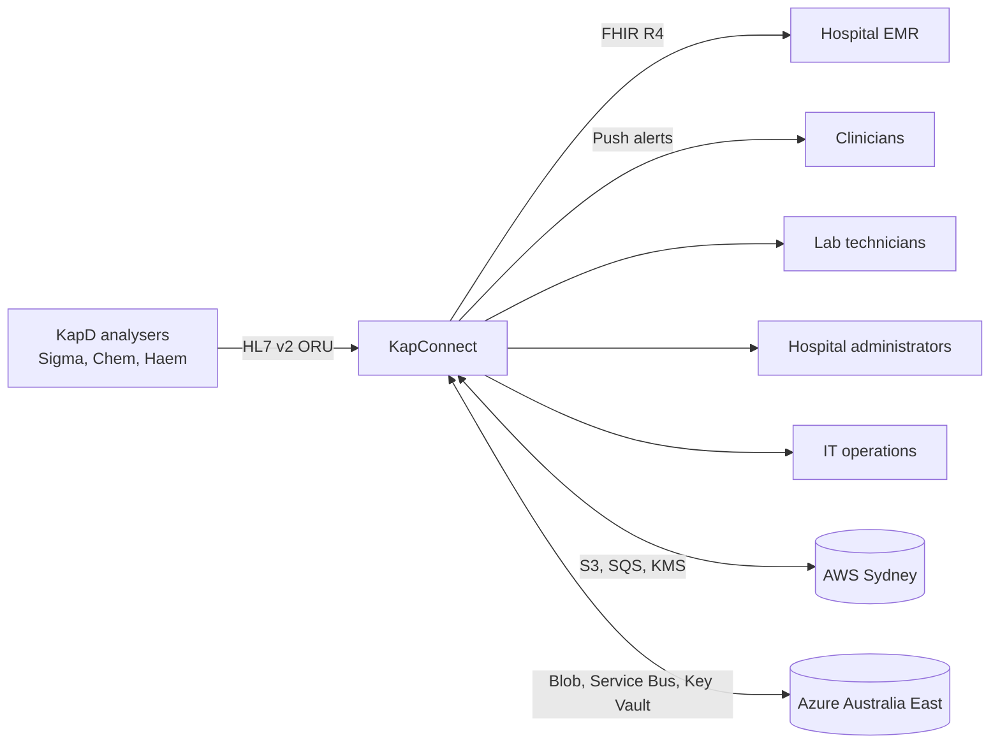
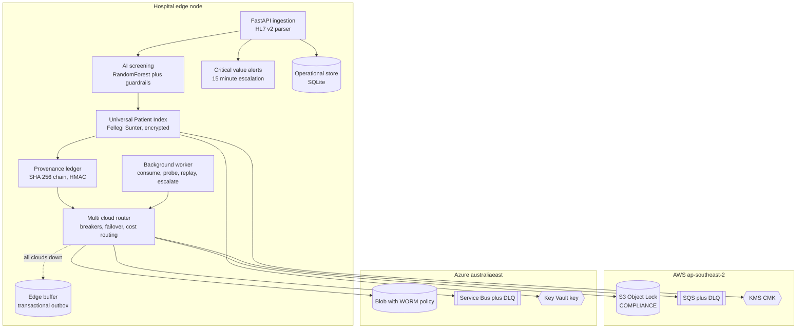
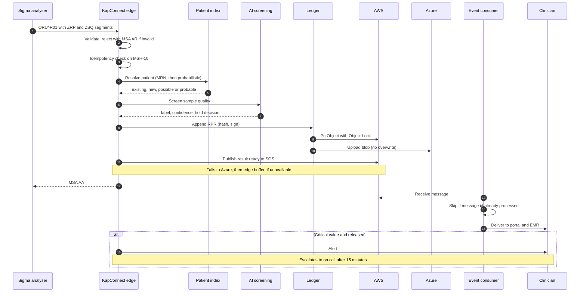
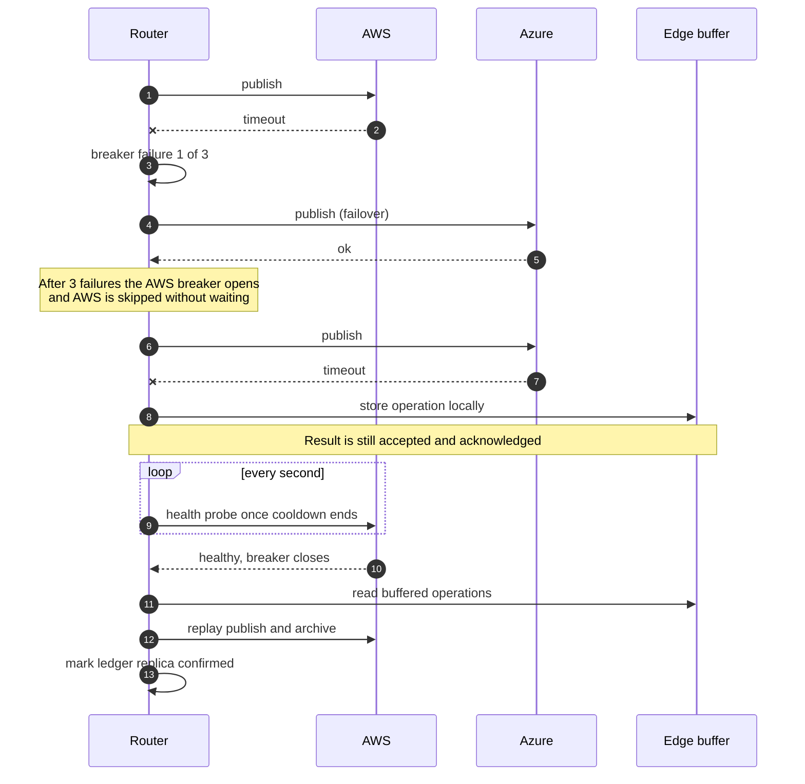
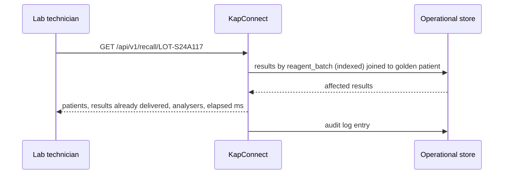
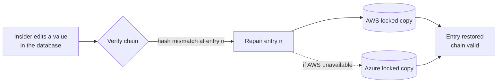
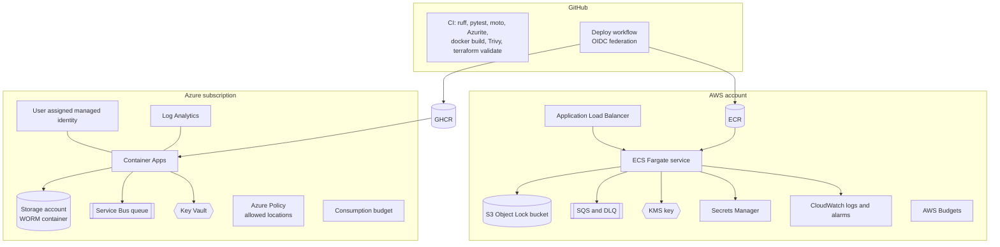

# KapConnect architecture

This document explains how KapConnect is put together and why. The README gives the short version.

## Contents

1. [Context](#context)
2. [Component view](#component-view)
3. [End to end result flow](#end-to-end-result-flow)
4. [Regional outage and recovery](#regional-outage-and-recovery)
5. [Reagent recall](#reagent-recall)
6. [Tamper detection and repair](#tamper-detection-and-repair)
7. [Deployment view](#deployment-view)
8. [Data model](#data-model)
9. [Security model](#security-model)
10. [Scaling path](#scaling-path)

## Context

Kappa Diagnostics (KapD) sells analysers such as the Sigma immunoassay unit. Hospitals connect those analysers to many different laboratory and hospital systems, often by hand. KapConnect is the digital services layer that sits between the analysers and everything downstream, and it has to keep working when a cloud region fails.

## Component view

| Component | Code | Responsibility |
| --- | --- | --- |
| Cloud abstraction | `app/cloud/base.py` | Three provider neutral interfaces: object store, message queue, key provider |
| AWS adapter | `app/cloud/aws.py` | S3 Object Lock, SQS with redrive policy, KMS data keys |
| Azure adapter | `app/cloud/azure.py` | Blob Storage, Storage Queue or Service Bus, Key Vault wrap and unwrap |
| Router | `app/cloud/router.py` | Circuit breakers, failover, dual writes, edge buffer, outage drills |
| FinOps | `app/cloud/finops.py` | Meters every call by provider, operation and site |
| Interoperability | `app/integration/` | HL7 v2 parsing and ACKs, FHIR R4 transaction bundles |
| Screening | `app/screening/model.py` | Pre analytical error detection |
| Patient index | `app/mpi/matcher.py` | Probabilistic matching, blind index lookup, review queue |
| Provenance | `app/provenance/ledger.py` | Hash chain, replication, verification, repair |
| Governance | `app/governance/policy.py` | Runtime compliance posture |
| Orchestration | `app/platform.py` | Wires the flow together |

## End to end result flow

Held samples do not raise critical value alerts. A haemolysed sample often shows a falsely high potassium, so the safe action is recollection rather than an emergency page.

## Regional outage and recovery

Ledger writes are replicated to every cloud, so a result written during an AWS outage has an Azure copy immediately and an AWS copy once AWS returns. The ledger row records the state of each replica (`pending` or its location), which is what `/api/v1/ledger/verify` reports.

## Reagent recall

The recall query uses the reagent batch recorded in each result's provenance. Results are joined to the golden patient identity, so a patient seen at two hospitals is counted once after an administrator links the records.

In a local benchmark of 3,000 results, a recall touching 300 results and 108 patients returned in under 4 ms.

## Tamper detection and repair

Each entry hash covers the previous hash and the canonical JSON of the entry, and the hash is signed with an HMAC key derived from the data key. Changing any field breaks the chain at that entry. The cloud copies cannot be edited or deleted before their retention date, so they are the source of truth for repair.

## Deployment view

Terraform lives in `infra/terraform/aws` and `infra/terraform/azure`. Both modules refuse regions outside Australia at plan time.

## Data model

| Table | Purpose |
| --- | --- |
| `patients` | Encrypted demographics (AES 256 GCM) and the golden identity |
| `patient_index` | HMAC blind index tokens used for candidate lookup |
| `match_reviews` | Possible and probable matches waiting for a decision |
| `results` | One row per observation with screening, provenance fields and FHIR bundle |
| `ledger` | Hash chained provenance entries and replica state |
| `alerts` | Critical values and their acknowledgement or escalation |
| `outbox` | Operations held at the edge while clouds are unavailable |
| `processed_messages` | Idempotency keys for the event consumer |
| `deliveries` | Where each released result was delivered |
| `keyring` | The data key wrapped by each cloud's key service |
| `audit_log` | Who did what and when |
| `cost_events` | Metered cloud usage |

## Security model

* **Identity.** Demo users sign in with short lived JWTs. Production would federate with Amazon Cognito or Microsoft Entra ID; `app/core/security.py` is the only module that changes.
* **Authorisation.** Every route declares a permission, for example `cloud:operate` or `reviews:decide`, and roles map to permission sets.
* **Data minimisation.** Roles without `phi:read` (IT operations, hospital administrators) receive masked names, dates of birth and identifiers, and FHIR bundles are redacted for them. The one exception is the match review queue, where administrators need full demographics to decide; every view of it is audited.
* **Encryption.** Patient demographics use envelope encryption. The data key is wrapped by AWS KMS and by Azure Key Vault, so either cloud can unlock the data.
* **No stored cloud keys.** Workloads use ECS task roles and Azure managed identity. Azure Storage account keys and Service Bus SAS keys are disabled in Terraform. GitHub deployments use OIDC.
* **Transport.** S3 denies non TLS requests, Azure enforces TLS 1.2, and the ALB supports TLS 1.3 when a certificate is supplied.
* **Audit.** Logins, ingestion outcomes, outage drills, recalls, match decisions and ledger operations are written to `audit_log`.

## Scaling path

The current build favours clarity and a zero setup demo. These are the next steps for production scale, in order:

1. Move the operational store from SQLite to Amazon Aurora PostgreSQL or Azure Database for PostgreSQL. All SQL sits in `app/storage/db.py` and the modules that call it, so the change is contained. This also removes the single replica limit set in Terraform.
2. Split the background worker into its own service so consumers scale separately from ingestion.
3. Replace polling consumers with Amazon MSK or Azure Event Hubs when volume moves past what SQS and Service Bus handle comfortably.
4. Send FHIR bundles to AWS HealthLake or Azure Health Data Services.
5. Retrain the screening model on real laboratory data with clinical governance.
